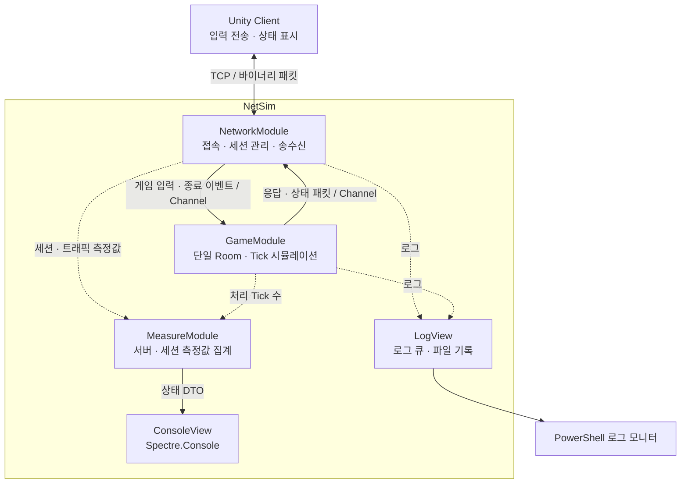

# NetSim (Network Simulation)

Unity 클라이언트의 이동 입력을 받아 서버에서 플레이어 상태를 계산하고, 그 결과를 접속자에게 전달하는 **TCP 기반 권위형 데디케이티드 게임 서버 프로토타입**입니다.

상용 네트워크 엔진에 의존하지 않고 C# 비동기 소켓 I/O, 바이너리 패킷 처리, Tick 기반 시뮬레이션을 직접 구현하며 네트워크 통신과 상태 동기화 과정을 연구하고 있습니다.

- **개발 기간:** 2026.04 ~ 진행 중
- **현재 구성:** 단일 서버 · 단일 Room · 최대 8개 세션 / 8명 플레이어
- **시뮬레이션:** 목표 64 Tick/s · 고정 이동 계산 간격 1/64초
- **상태 전달:** 매 Tick(1 Tick 간격) 상태 패킷 생성 후 비동기 송신
- **연관 프로젝트:** [NetSimClient](https://github.com/LEEHAESUGIT/NetSimClient)

## 목차

- [현재 구현 범위](#현재-구현-범위)
- [개발 환경](#개발-환경)
- [실행 방법](#실행-방법)
- [시스템 구성과 처리 흐름](#시스템-구성과-처리-흐름)
- [프로젝트 구조](#프로젝트-구조)
- [코드 탐색 안내](#코드-탐색-안내)
- [현재 한계와 개선 과제](#현재-한계와-개선-과제)
- [개발 배경](#개발-배경)

## 현재 구현 범위

| 기능 | 구현 내용 |
| --- | --- |
| 서버 권위형 이동 | SessionID와 Generation으로 입력 소유권을 확인하고, Tick별 이동 플래그를 보관한 뒤 서버에서 위치 계산 |
| Tick 기반 시뮬레이션 | 고정 `deltaTime`으로 플레이어별 이동을 Tick당 한 번 계산하고, 실제 작업·대기 시간을 반영해 루프 간격 조절 |
| 상태 동기화 | 매 Tick 전체 플레이어 스냅샷과 소유자용 상태 응답을 생성하여 클라이언트의 보간·재조정에 필요한 기준 전달 |
| 자체 바이너리 프로토콜 | 6바이트 고정 헤더와 가변 본문, 직렬화·역직렬화, TCP 수신 버퍼에서 패킷 경계 분리 |
| 비동기 처리와 세션 관리 | `Channel<T>` 기반 패킷·이벤트 전달, 비동기 송수신, Heartbeat 감시, 세션 종료 작업 관측과 풀 반환 |
| 모니터링과 로그 | 실제 경과 시간 기준 TPS·송수신량 집계, 서버·세션 상태 콘솔 표시, Channel 기반 파일 로그 기록 |

서버는 **이동 계산과 상태 전달**을 담당합니다. 원격 플레이어의 화면 보간과 로컬 플레이어의 예측·재조정은 NetSimClient에서 수행합니다. 현재는 이동 동기화를 중심으로 구현하고 있으며, 충돌 판정과 여러 Room의 독립 운영은 구현 범위에 포함하지 않습니다.

## 개발 환경

| 구분 | 환경 |
| --- | --- |
| 개발 도구 | Visual Studio 2022 |
| 언어 / 서버 런타임 | C# / .NET 8 (`net8.0`) |
| 실행 환경 | Windows · PowerShell 로그 모니터 사용 |
| 네트워크 | TCP/IP · `TcpListener`, `TcpClient`, `NetworkStream` |
| 비동기 처리 | `Task`, `async/await`, `CancellationToken`, `Channel<T>` |
| 데이터 처리 | `Span<T>`, `Memory<T>`, `BinaryPrimitives`, `FrozenDictionary` |
| 콘솔 UI | Spectre.Console 0.57.2 |
| 연동 클라이언트 | Unity 6000.3.9f1 · 별도 NetSimClient 저장소 |

`NetSimCore`는 실행 프로젝트이며, `NetSimShared`와 `NetSimViewConsole`은 서버가 참조하는 라이브러리입니다. 두 라이브러리를 별도로 실행할 필요는 없습니다.

## 실행 방법

### 1. 서버 준비

1. 이 저장소를 내려받고 .NET 8 SDK를 준비합니다.
2. `NetSimCore` 폴더의 `NETSIM.sln`을 Visual Studio에서 엽니다.
3. `NETSIM` 프로젝트의 `Shared`, `NETSIM_ConsoleView` 참조가 연결되는지 확인합니다.
4. NuGet 패키지를 복원하고 `NETSIM`을 시작 프로젝트로 지정합니다.

**프로젝트 참조 확인:** 현재 `NETSIM.csproj`의 두 프로젝트 참조는 작성자 환경의 절대 경로로 지정되어 있습니다. 다른 PC에서 참조를 찾지 못하면 Visual Studio에서 해당 참조를 제거한 뒤, 솔루션의 `Shared`와 `NETSIM_ConsoleView` 프로젝트를 다시 참조하도록 설정해야 합니다.

### 2. 서버 실행

Visual Studio에서 시작 프로젝트를 실행합니다. 터미널에서는 프로젝트 참조를 확인한 뒤, `NetSimCore` 폴더에서 다음 명령을 사용합니다.

```powershell
dotnet restore NETSIM.csproj
dotnet run --project NETSIM.csproj
```

서버는 **TCP 9999 포트**에서 연결을 기다립니다. 서버 콘솔에는 상태 대시보드가 표시되고, 별도의 PowerShell 창에서는 로그를 확인할 수 있습니다.

### 3. 클라이언트 연결

1. [NetSimClient](https://github.com/LEEHAESUGIT/NetSimClient) 저장소를 내려받습니다.
2. Unity 6000.3.9f1에서 프로젝트를 엽니다.
3. `Scenes` 폴더의 `SampleScene.unity`를 열고 Play를 실행합니다.
4. 방향키 또는 WASD로 플레이어를 이동합니다.

클라이언트의 기본 접속 대상은 **같은 PC의 `127.0.0.1:9999`**입니다. 다른 PC에서 접속하려면 클라이언트의 접속 주소를 서버 주소로 변경해야 합니다.

### 4. 확인할 동작과 종료

| 상황 | 확인할 내용 |
| --- | --- |
| 서버만 실행 | 대시보드의 서버 실행 상태, TPS와 가동 시간 |
| 클라이언트 접속 | 세션 수와 세션 정보 변경, 플레이어 생성 |
| 플레이어 이동 | 화면의 이동 결과와 서버의 이동 명령 표시, 송수신량 변화 |
| 클라이언트 여러 개 연결 | 각 클라이언트에서 다른 플레이어의 생성과 이동 확인 |
| 클라이언트 종료 | 서버의 세션 해제·풀 반환 로그와 세션 수 변화 |

여러 클라이언트 비교에는 Unity Editor와 별도로 빌드한 클라이언트 실행 파일을 함께 사용할 수 있습니다.

서버 종료는 서버 콘솔에서 **Ctrl+C**를 사용합니다. 취소 신호를 전달한 뒤 서버의 모듈과 세션 작업 종료를 기다리는 경로로 진입합니다. 별도로 열린 로그 모니터 창은 확인 후 닫습니다. 로그 파일은 실행 파일 기준 `Logs` 폴더에 기록됩니다.

위 실행 안내는 현재 코드와 프로젝트 설정을 기준으로 작성했습니다. 신규 PC에서의 설치·실행과 다중 접속 시나리오는 별도 확인이 필요합니다.

## 시스템 구성과 처리 흐름

### 모듈 구성



네트워크·게임·측정 모듈은 같은 서버 프로세스에서 동작합니다. 네트워크와 게임은 Pipe를 통해 데이터를 주고받고, 플레이어 상태 갱신은 Room의 Tick 루프에서 진행합니다.

### 이동 입력에서 상태 전달까지

1. **수신과 패킷 복원:** `Session`이 수신 버퍼에 바이트를 모으고, 헤더의 길이를 기준으로 완성된 패킷을 분리합니다. `PacketFormatter`가 패킷 ID에 맞춰 역직렬화합니다.
2. **입력 전달과 검증:** 게임 패킷을 InBoundPipe에 넣고, Room이 Tick당 최대 500개를 꺼내 라우터에 전달합니다. 이동 핸들러는 소유 세션과 Generation을 확인한 뒤 입력 Tick·이동 플래그를 보관합니다.
3. **서버 시뮬레이션:** 이번 시점까지 적용 가능한 최신 입력을 선택하고, 플레이어별로 고정 `deltaTime`을 사용해 한 번 이동을 계산합니다. 새 입력이 없으면 이전 이동 플래그를 유지합니다.
4. **상태 패킷 생성:** 이동 계산 후 매 Tick 현재 플레이어 상태를 캡처합니다. 전체 스냅샷은 전체 접속자에게, 입력 시뮬레이션이 시작된 플레이어의 상태는 소유 세션에 전달하도록 패킷을 만듭니다.
5. **비동기 송신:** `GamePacketOperator`의 임시 큐 → OutBoundPipe → `PacketSender` → 세션 송신 큐 → `NetworkStream.WriteAsync` 순서로 전송합니다.

| 상태 패킷 | 전달 내용 | 클라이언트의 사용 목적 |
| --- | --- | --- |
| `S_AllInterpolation` | 서버 Tick, 플레이어 목록과 위치·방향 | 원격 플레이어의 스냅샷 보간 |
| `S_Transform` | 소유 플레이어의 위치·방향, `ClientPastTick` | 서버 상태 복원과 미확정 입력 재실행 |

`ClientPastTick`에는 서버가 입력 시간축에서 시뮬레이션을 마친 시점을 넣습니다. 새 입력 없이 이전 플래그를 유지한 구간도 포함하므로, 마지막으로 수신한 입력 번호와는 다를 수 있습니다.

초기화·Heartbeat 등 시스템 패킷은 별도 시스템 처리 루프에서 소비합니다. 연결 종료 이벤트는 Room의 이벤트 처리 단계로 전달됩니다.

### 바이너리 패킷 형식

| 영역 | 크기 | 내용 |
| --- | --- | --- |
| 전체 길이 | 2바이트 · `ushort` | 헤더를 포함한 패킷 길이 |
| 패킷 ID | 4바이트 · `int` | 처리할 패킷 종류 |
| 본문 | 패킷별 가변 | Tick, 플레이어 정보, 이동 플래그 등 |

헤더의 정수는 Little Endian으로 기록합니다. 수신한 데이터에 헤더나 본문이 부족하면 다음 수신을 기다리고, 여러 패킷이 함께 도착하면 완성된 패킷을 차례로 분리합니다.

## 프로젝트 구조

주요 소스 폴더와 탐색에 필요한 파일을 표시했습니다. 빌드 결과물, IDE 설정, 개인 작업 지침은 생략했습니다.

```text
NetSim/
├── NetSimCore/                       # 서버 실행 프로젝트
│   ├── Common/
│   │   ├── LiveServerData.cs
│   │   └── ServerDataConfigration.cs
│   ├── Domain/
│   │   ├── State/
│   │   └── DTOFactory.cs
│   ├── Event/
│   ├── GameCore/
│   │   ├── Function/
│   │   ├── GameRoom/
│   │   │   ├── GameEntity/
│   │   │   │   ├── Component/
│   │   │   │   ├── Snapshots/
│   │   │   │   └── Player.cs
│   │   │   ├── TickBuffer/
│   │   │   └── Room.cs
│   │   ├── Manager/
│   │   └── GameModule.cs
│   ├── Mapper/
│   ├── MeasureCore/
│   │   ├── Measure/
│   │   └── MeasureModule.cs
│   ├── NetworkCore/
│   │   ├── Function/
│   │   ├── Manager/
│   │   ├── Service/
│   │   └── NetworkModule.cs
│   ├── Packet/
│   │   ├── Packets/
│   │   │   ├── ForIngame/
│   │   │   ├── ForSystem/
│   │   │   └── SharedPacket/
│   │   ├── Tool/
│   │   └── PacketOperator.cs
│   ├── Pipe/
│   │   ├── EventDispatch/
│   │   ├── EventPipe/
│   │   ├── PacketDispatch/
│   │   ├── PacketPipe/
│   │   └── Pipe.cs
│   ├── Router/
│   │   ├── Handle/
│   │   └── Init/
│   ├── Sockets/
│   │   ├── Buffer/
│   │   └── Session.cs
│   ├── Types/
│   │   ├── Enum/
│   │   └── Interface/
│   ├── ProgramMain.cs
│   ├── ServerMain.cs
│   ├── NETSIM.csproj
│   └── NETSIM.sln
│
├── NetSimShared/                     # 서버와 콘솔 사이의 공유 데이터
│   ├── DTO/
│   │   └── Function/
│   ├── Enum/
│   └── Shared.csproj
│
├── NetSimViewConsole/                # 콘솔 화면과 로그
│   ├── Common/
│   │   └── Tool/
│   ├── Configration/
│   ├── Draw/
│   ├── LogMonitor/
│   ├── ConsoleView.cs
│   └── NETSIM_ConsoleView.csproj
│
└── README.md
```

## 코드 탐색 안내

처음에는 **`ProgramMain.cs` → `ServerMain.cs` → `Room.cs`** 순서로 읽으면 실행 시작, 모듈 구성, 게임 처리 순서를 파악할 수 있습니다.

| 살펴볼 내용 | 주요 파일 | 확인할 역할 |
| --- | --- | --- |
| 실행과 종료 | `ProgramMain.cs`, `ServerMain.cs` | 시작점, 모듈 생성, 취소 신호와 종료 대기 |
| 서버 접속과 세션 | `NetworkModule.cs`, `SessionManager.cs`, `Session.cs` | 접속 수락, 세션 재사용, 송수신 Task 생명주기 |
| 입력 처리와 이동 | `GameHandle.cs`, `Player.cs`, `WorldTickBuffer.cs` | 입력 검증, Tick별 입력 보관·선택, 서버 위치 계산 |
| 플레이어 상태 분리 | `PlayerTickComponent.cs`, `PlayerMoveFlagComponent.cs`, `PlayerTransformComponent.cs` | 입력 시간축, 이동 플래그, 위치·방향 관리 |
| Tick과 상태 전송 | `Room.cs`, `PacketOperator.cs`, `PacketSender.cs` | Tick 처리 순서, 상태 패킷 생성, 전송 대상 선택 |
| 패킷과 전달 경계 | `PacketFormatter.cs`, `PacketRWTool.cs`, `Pipe.cs` | 바이너리 변환과 Channel 기반 데이터 전달 |
| 측정과 화면 | `MeasureModule.cs`, `DTOFactory.cs`, `ConsoleView.cs`, `LogView.cs` | 측정값 집계, DTO 변환, 콘솔 표시와 로그 기록 |

`WorldTickBuffer.cs`에는 현재 플레이어의 미적용 입력을 보관하는 `TickOfPlayerFlagBuffer`가 정의되어 있습니다. Room의 과거 월드 상태를 매 Tick 기록하는 단계는 현재 루프에 없습니다.

## 현재 한계와 개선 과제

- **소규모 단일 Room:** 현재 최대 8개 세션과 단일 Room을 대상으로 합니다. 다중 Room, 분산 서버와 대규모 부하 처리는 별도 과제입니다.
- **Tick 시간축:** 64 Tick/s는 목표값입니다. 클라이언트와 서버의 입력 Tick 대응은 최초 기준점과 같은 Tick 진행 속도를 전제로 하며, 장기적인 시계 drift 보정은 구현하지 않았습니다.
- **입력 적용 정책:** 적용 가능한 입력 중 최신 플래그를 선택합니다. 지연된 입력을 과거 Tick으로 되돌려 재계산하지 않으므로, 짧은 방향 전환이 생략될 수 있습니다.
- **큐 적체와 TCP 지연:** 현재 Channel은 용량 제한이 없습니다. 소비보다 입력·출력이 빠른 상황의 backpressure와, TCP 재전송으로 인한 후속 데이터 지연을 검증할 필요가 있습니다.
- **검증 범위:** 비정상 패킷 경계 조건, 반복 접속·종료와 종료 경합을 보완·검증할 필요가 있습니다. 세션·플레이어 재사용은 구현되어 있지만, GC 감소나 처리량 향상을 측정한 벤치마크 결과는 이 문서에서 제시하지 않습니다.

## 개발 배경

플레이어 호스트가 종료되면 다른 접속자도 게임을 이어가기 어려운 경험에서 출발했습니다. Host Migration을 검토한 뒤, 우선 네트워크와 동기화의 기본 구조를 이해하기 위해 서버와 클라이언트를 분리한 Dedicated Server를 직접 구현하기로 했습니다.
